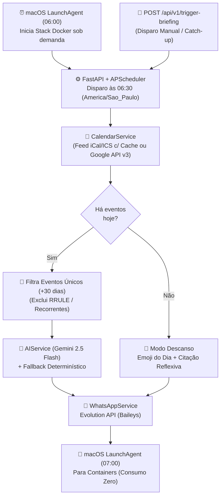

# Agenda Daily Briefing Agent 📅🤖💬

Agente autônomo pessoal que consulta sua agenda do **Google Calendar**, elabora um *briefing* executivo matinal usando **Google Gemini (`gemini-2.5-flash`)** e entrega o resumo diretamente no seu **WhatsApp** todos os dias às **06:30**.

Além dos compromissos do dia, o agente antecipa **eventos únicos (não recorrentes) dos próximos 30 dias** para que prazos, consultas ou reuniões esporádicas nunca passem despercebidos — e, em dias livres, envia uma mensagem dedicada ao descanso sem ruído de trabalho.

---

## 📋 Índice

1. [Visão Geral e Fluxo de Funcionamento](#-visão-geral-e-fluxo-de-funcionamento)
2. [Escolhas Técnicas e Decisões de Arquitetura](#-escolhas-técnicas-e-decisões-de-arquitetura)
3. [Funcionalidades Inteligentes do Briefing](#-funcionalidades-inteligentes-do-briefing)
4. [Estrutura do Projeto](#-estrutura-do-projeto)
5. [Como Configurar e Executar](#-como-configurar-e-executar)
6. [Janela Diária de Economia de Recursos (macOS)](#-janela-diária-de-economia-de-recursos-macos)
7. [Testes e Diagnóstico](#-testes-e-diagnóstico)

---

## 🔄 Visão Geral e Fluxo de Funcionamento



---

## 🛠 Escolhas Técnicas e Decisões de Arquitetura

O projeto foi arquitetado para equilibrar **privacidade, custo zero de APIs de mensageria, tolerância a falhas e eficiência energética/memória na máquina local**.

### 1. Dupla Estratégia de Leitura do Google Calendar (`ICS` vs. `API v3`)
Configurar OAuth2 ou Service Accounts no Google Cloud Console pode ser excessivamente burocrático para automações pessoais. Por isso, o `CalendarService` (`src/services/calendar_service.py`) suporta três modos transparentes em cascata:
1. **Feed iCal/ICS Privado (`GOOGLE_CALENDAR_ICS_URL`):** Utiliza as bibliotecas `icalendar` e `recurring-ical-events` para expandir regras complexas de recorrência (`RRULE`, `EXDATE`, fusos horários) diretamente do link privado `.ics` da agenda. Implementa **cache em memória (`_ics_cache`)** para realizar apenas um download HTTP por execução (servindo tanto a consulta do dia quanto a janela de 30 dias).
2. **Google Calendar API v3 (`GOOGLE_SERVICE_ACCOUNT_FILE`):** Suporte oficial via credenciais JSON de Service Account (`google-api-python-client`) com escopo estritamente *read-only* (`calendar.readonly`).
3. **Modo Mock Automático:** Caso nenhuma credencial esteja configurada, o serviço retorna eventos simulados realistas, permitindo validar todo o pipeline e testes sem depender de rede externa.

### 2. Algoritmo de Filtragem de Eventos Únicos de 30 Dias
Avisar sobre os próximos 30 dias seria inútil se o resumo listasse dezenas de *dailies*, aulas semanais ou reuniões recorrentes.
* **Como foi resolvido:** No parser ICS e na API v3, o agente constrói um conjunto de `recurring_uids` varrendo todos os componentes `VEVENT` que possuam propriedades `RRULE`, `RDATE` ou `RECURRENCE-ID` (incluindo exceções movidas de uma série recorrente). Apenas eventos genuinamente pontuais/únicos dentro da janela `[hoje + 1 dia, hoje + 30 dias]` são enviados ao resumo.

### 3. Google Gemini (`gemini-2.5-flash`) com Fallback Determinístico *Zero-Downtime*
* **Por que `gemini-2.5-flash` via SDK `google-genai`?** É o modelo ideal para tarefas de sumarização estruturada de baixa latência, compreendendo perfeitamente regras de formatação nativa do WhatsApp (`*negrito*`, `_itálico_`), extração de links do Google Meet e identificação de **reuniões coladas** (intervalo menor que 15 minutos entre o término de uma e o início da próxima).
* **Resiliência Determinística (`_fallback_briefing`):** A chamada à LLM possui timeout estrito de `8000ms`. Se a API do Gemini estiver indisponível, sem cota ou se o usuário optar por rodar sem `GEMINI_API_KEY`, o agente aciona instantaneamente um formatador determinístico local que garante a entrega pontual do briefing às 06:30.

### 4. Evolution API Self-Hosted Otimizada (WhatsApp via Baileys)
* **Por que Evolution API local?** Permite enviar mensagens para o próprio número no WhatsApp sem custos por mensagem ou aprovação de templates da Meta Cloud API.
* **Otimização de Memória e Privacidade no `docker-compose.yml`:** Por padrão, engines baseadas em Baileys tentam sincronizar todo o histórico de conversas e contatos do aparelho pareado. Desativamos explicitamente essa coleta (`SYNC_FULL_HISTORY=false`, `DATABASE_SAVE_DATA_NEW_MESSAGE=false`, `DATABASE_SAVE_DATA_CONTACTS=false`, `DATABASE_SAVE_DATA_CHATS=false`) e configuramos o Redis apenas em memória (`--appendonly no`). Isso reduz drasticamente o uso de RAM/CPU e impede que suas conversas pessoais fiquem gravadas no banco do container.
* **Isolamento em Loopback (`127.0.0.1`):** As portas `8080` (Evolution API) e `8000` (FastAPI) fazem bind exclusivamente em `127.0.0.1`, impedindo acesso externo na rede local.

### 5. Janela Diária de Execução (`06:00` às `07:00`) e Contorno do macOS TCC
Manter PostgreSQL, Redis, Node.js (Evolution API) e Python (FastAPI) ativos 24 horas por dia consumiria memória desnecessariamente para uma tarefa que ocorre uma vez por manhã:
* **Orquestração de Janela (`scripts/container_window.sh`):** Através de dois agentes do `launchd` no macOS (`com.agenda-agent.window-start` às 06:00 e `com.agenda-agent.window-stop` às 07:00), os containers são ligados às 06:00, o briefing é disparado às 06:30 e toda a stack é desligada às 07:00.
* **Lógica de *Catch-up*:** Se o computador estiver em *sleep* às 06:00 e acordar, por exemplo, às 06:42, o script detecta que já passou do horário do cron (`06:30`) e aciona imediatamente o endpoint `POST /api/v1/trigger-briefing`.
* **Contorno de Permissão TCC do macOS:** Processos iniciados pelo `launchd` em background sofrem bloqueio do macOS (*Transparency, Consent, and Control — `Operation not permitted`*) ao tentar acessar arquivos dentro de `~/Documents`. O instalador (`scripts/install_window_schedule.sh`) resolve isso copiando o script executor para `~/.agenda-agent/container_window.sh` e iniciando os containers diretamente pelo socket do Docker (`docker start` / `docker stop`).

---

## ✨ Funcionalidades Inteligentes do Briefing

* **Rotação Determinística de Emojis (`GREETING_EMOJIS`):** A saudação matinal alterna diariamente entre 33 emojis de natureza e emoções positivas com base no ordinal da data (`date.toordinal() % len`), garantindo que dois dias seguidos nunca tenham o mesmo ícone.
* **Modo Descanso em Dias Livres:** Quando não há nenhum evento agendado para hoje, o agente não chama a LLM nem lista eventos futuros dos próximos 30 dias — em vez disso, envia uma mensagem acolhedora lembrando da importância do descanso acompanhada de uma citação reflexiva do dia (`REST_QUOTES`).
* **Extração Automática de Links do Google Meet:** Detecta links `https://meet.google.com/...` tanto nos metadados nativos (`hangoutLink` / `conferenceData`) quanto no corpo da descrição ou localização do evento (via Regex).

---

## 📂 Estrutura do Projeto

```text
agenda-agent/
├── src/
│   ├── main.py                      # API FastAPI (/health e /api/v1/trigger-briefing) + Lifespan
│   ├── config.py                    # Validação tipada de variáveis de ambiente via Pydantic Settings
│   ├── scheduler.py                 # Orquestração do job diário com APScheduler + Timezone
│   └── services/
│       ├── calendar_service.py      # Leitura ICS (com cache) / Google API v3 + filtro de recorrência
│       ├── ai_service.py            # Prompt engineering Gemini 2.5 Flash, emojis diários e fallback
│       └── whatsapp_service.py      # Cliente REST para envio via Evolution API com sanitização E.164
├── scripts/
│   ├── bootstrap.sh                 # Setup completo: gera .env, sobe stack, cria instância e testa
│   ├── connect_whatsapp.sh          # Recria instância limpa e exporta o QR Code (qrcode.png)
│   ├── get_qrcode.py                # Verifica estado da conexão e atualiza o QR Code se desconectado
│   ├── diag_whatsapp.py             # Diagnóstico de leitura e contagem de eventos do feed ICS
│   ├── apply_schedule.sh            # Dispara manualmente o briefing no container em execução
│   ├── container_window.sh          # Gerenciador da janela diária (06:00-07:00) com catch-up
│   └── install_window_schedule.sh   # Instala os LaunchAgents de início (06:00) e parada (07:00) no macOS
├── tests/
│   └── test_mock_flow.py            # Testes automatizados de agenda, emojis, descanso e recorrência
├── credentials/
│   └── .gitkeep                     # Diretório para service_account.json (ignorado pelo Git)
├── Dockerfile                       # Imagem Python 3.11-slim do agente FastAPI
├── docker-compose.yml               # Stack completa: Postgres 15, Redis 7, Evolution API e Agenda Agent
├── requirements.txt                 # Dependências Python
└── .env.example                     # Template de configuração sem dados sensíveis
```

---

## 🚀 Como Configurar e Executar

### 1. Pré-requisitos
* **Docker** e **Docker Compose** instalados.
* Uma agenda no **Google Calendar** (link privado `.ics` ou arquivo `service_account.json`).
* *(Opcional)* Uma chave de API do **Google Gemini** (`GEMINI_API_KEY`).

### 2. Configurar o `.env`
Copie o arquivo de exemplo ou deixe que o script `bootstrap.sh` gere automaticamente uma `EVOLUTION_API_KEY` aleatória:
```bash
cp .env.example .env
```
Edite o arquivo `.env` com suas informações:
* `DESTINATION_PHONE`: Seu número de WhatsApp no formato DDI + DDD + Número (ex.: `5511999999999`).
* `GOOGLE_CALENDAR_ICS_URL`: URL secreta em formato iCal da sua agenda (Configurações do Google Calendar $\rightarrow$ Integrar agenda $\rightarrow$ *Endereço secreto no formato iCal*). Alternativamente, coloque o arquivo `service_account.json` na pasta `./credentials/`.
* `GEMINI_API_KEY`: Sua chave do Google AI Studio (se deixada em branco, o agente usará o formatador determinístico local).

### 3. Subir a Stack e Conectar o WhatsApp
Execute o script de bootstrap:
```bash
./scripts/bootstrap.sh
```
Para gerar o arquivo `qrcode.png` na raiz do projeto e parear seu WhatsApp:
```bash
./scripts/connect_whatsapp.sh
```
Abra o arquivo `qrcode.png` gerado e escaneie pelo WhatsApp (**Aparelhos Conectados $\rightarrow$ Conectar um aparelho**).

### 4. Testar um Disparo Imediato
Com os containers rodando e o WhatsApp conectado, dispare um resumo agora mesmo:
```bash
./scripts/apply_schedule.sh
```
Ou via requisição HTTP:
```bash
curl -X POST http://127.0.0.1:8000/api/v1/trigger-briefing
```

---

## 🔋 Janela Diária de Economia de Recursos (macOS)

Para que os containers fiquem ligados **apenas entre 06:00 e 07:00 da manhã** (economizando memória RAM durante o resto do dia):

```bash
./scripts/install_window_schedule.sh
```

Para testar manualmente a abertura ou fechamento da janela fora do horário:
```bash
# Força a inicialização dos containers e o disparo imediato do briefing
./scripts/container_window.sh start --force

# Encerra todos os containers da stack
./scripts/container_window.sh stop
```

---

## 🧪 Testes e Diagnóstico

Para validar a lógica de rotação diária de emojis, formatação com/sem eventos e o filtro de exclusão de eventos recorrentes:
```bash
python3 tests/test_mock_flow.py
```
